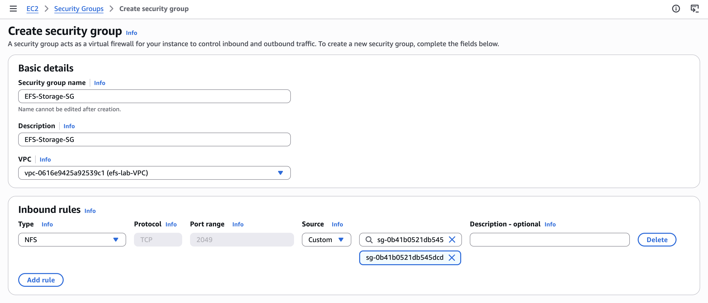
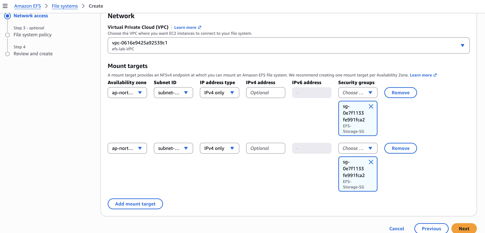
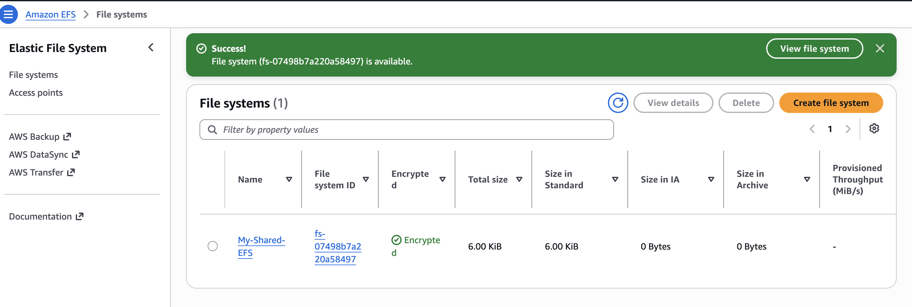
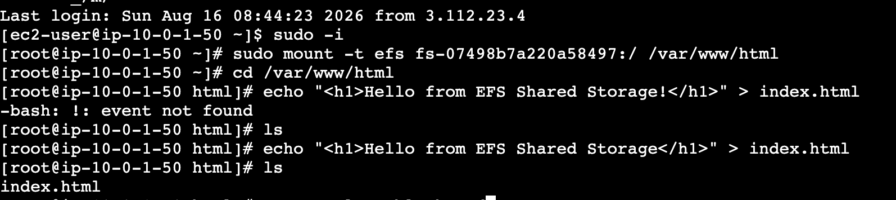
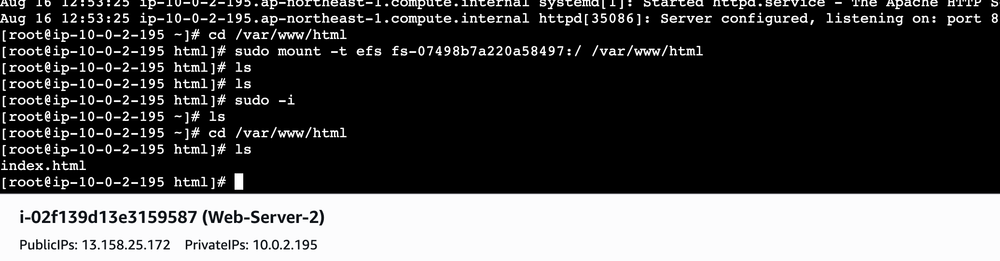
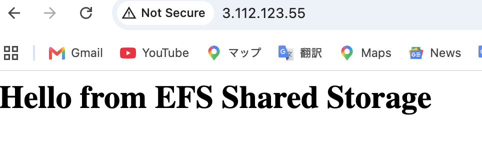
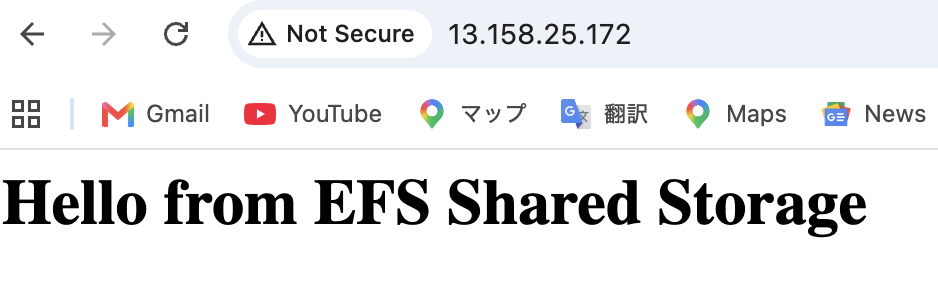

[日本語版 (Japanese Version)](./README_ja.md)
# Centralized Shared Storage for Multi-AZ Web Servers using Amazon EFS

## Executive Summary
This project demonstrates the architecture and implementation of a highly available, centralized shared file system using **Amazon Elastic File System (EFS)** for web servers deployed across multiple Availability Zones (AZs) in **Amazon VPC**. 

By mounting a single EFS file system to Apache (`httpd`) web servers running on multiple **Amazon EC2** instances, any web content or static assets created on one server are immediately accessible and synchronized across all servers without manual replication.

---

##  Architecture & AWS Infrastructure
The setup consists of the following components:
* **Custom VPC (`10.0.0.0/16`)**: Built from scratch with DNS resolution and DNS hostnames enabled.
* **Public Subnets**: Deployed in two distinct Availability Zones (`ap-northeast-1a` and `ap-northeast-1c`) for High Availability (HA).
* **EC2 Instances**: Launched two Amazon Linux 2023 instances (`Web-Server-1` and `Web-Server-2`).
* **Security Groups**:
  * `EFS-Web-SG`: Allows HTTP (Port 80) and SSH (Port 22) from anywhere (`0.0.0.0/0`).
  * `EFS-Storage-SG`: Allows NFS (Port 2049) traffic **strictly** from `EFS-Web-SG`.
* **Amazon EFS**: Regional file system with mount targets created in both public subnets.

---

## Step-by-Step Implementation

### 1. Security Group Configuration
To enforce least-privilege security, `EFS-Storage-SG` permits NFS (2049) connections only from instances attached to `EFS-Web-SG`.

### 2. EFS Creation & Network Setup
Provisioned a Regional EFS file system (`My-Shared-EFS`) with Mount Targets associated with `EFS-Storage-SG` in each subnet.

### 3. Mounting EFS to Web Servers
Installed `amazon-efs-utils` on both EC2 instances and mounted the file system to the document root directory `/var/www/html`.

    # Install helper utilities
    sudo dnf install amazon-efs-utils -y

    # Mount EFS to Apache web directory
    sudo mount -t efs fs-07498b7a220a58497:/ /var/www/html

---

## Troubleshooting & Lessons Learned

During the setup process, real-world deployment challenges were encountered and resolved:

### Issue 1: `unknown filesystem type 'efs'`
* **Root Cause**: Missing EFS mount helper utilities on the Amazon Linux OS.
* **Resolution**: Installed `amazon-efs-utils` via `dnf`.

### Issue 2: `Could not resolve hostname` / Timeout
* **Root Cause**: Custom VPC was created without enabling **DNS Resolution** and **DNS Hostnames**, preventing DNS lookup of the EFS endpoint.
* **Resolution**: Enabled both DNS flags in the VPC settings.

### Issue 3: `Failed to import necessary dependency botocore`
* **Root Cause**: The EFS helper tool required Python's `botocore` package to retrieve Mount Target IP addresses.
* **Resolution**: Executed `sudo dnf install python3-botocore -y` and rebooted the instance.

### Issue 4: Directory Context Refresh Quirk
* **Root Cause**: Mounting EFS onto `/var/www/html` while currently inside that working directory leaves the shell referencing the pre-mount local directory.
* **Resolution**: Navigated out of `/var/www/html` and back in (`cd /var/www/html`) or refreshed root context (`sudo -i`) to expose the mounted EFS storage.

---

## Validation & Results

An `index.html` file was created on **Web-Server-1**. Both servers were verified via public browser requests:

1. **Web-Server-1 (Public IP: 3.112.123.55)**
   

2. **Web-Server-2 (Public IP: 13.158.25.172)**
   

**Conclusion**: Both independent web servers successfully served the identical web page stored on the centralized Amazon EFS volume.
