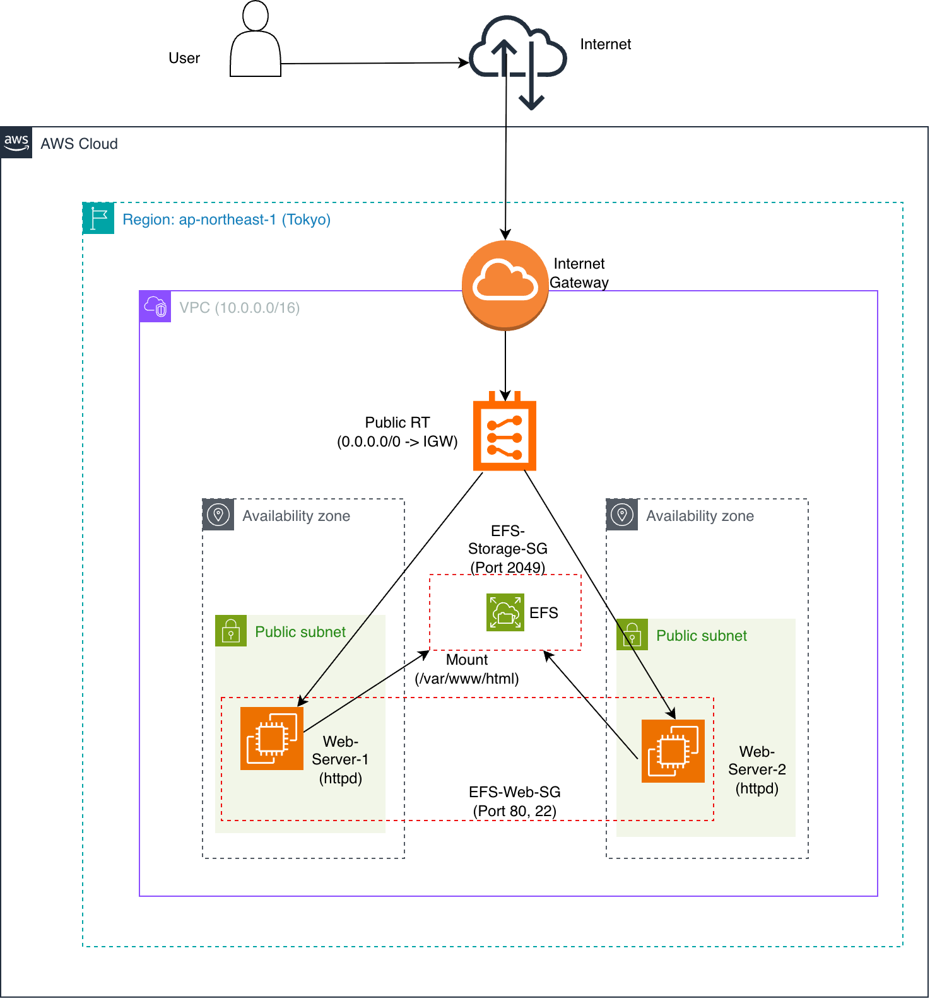
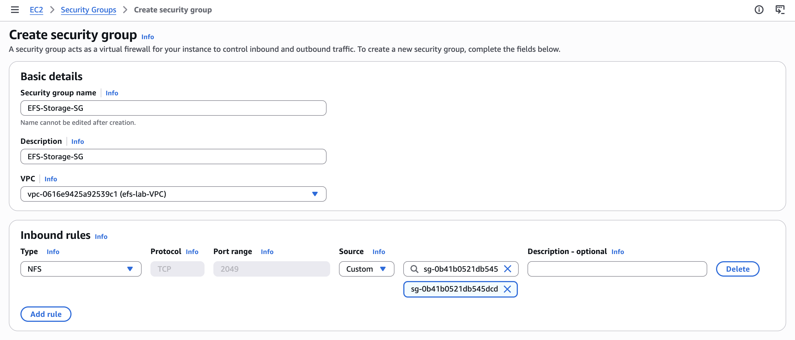
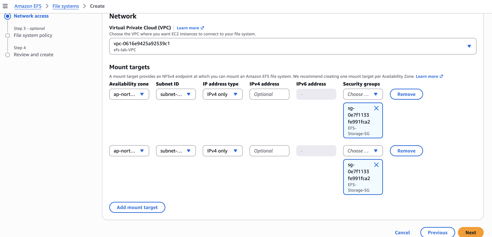
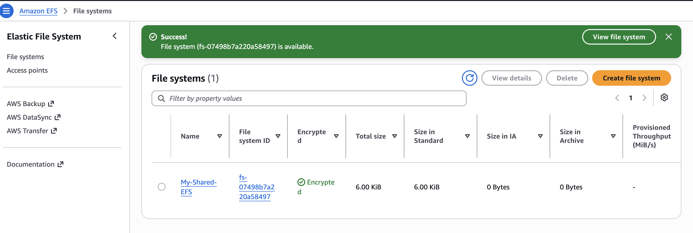
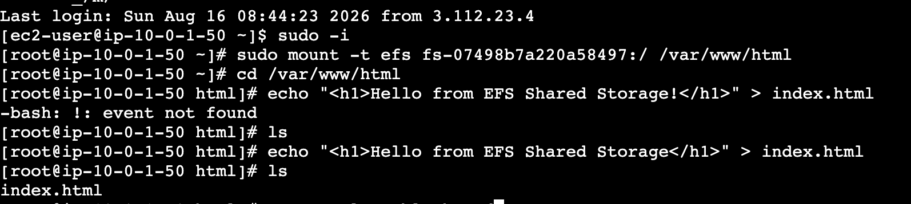
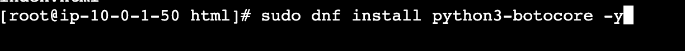
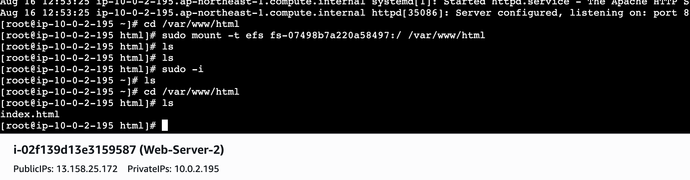
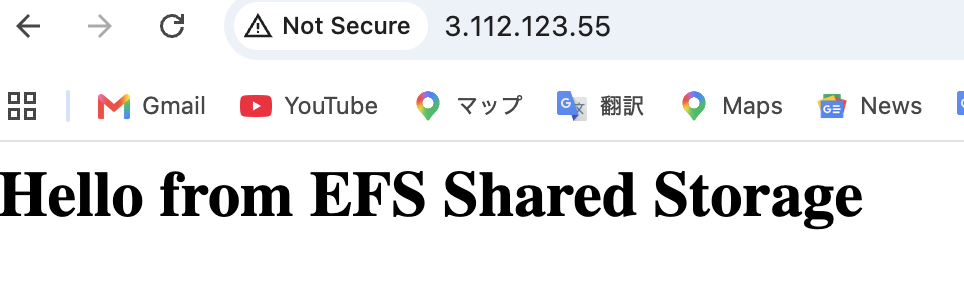
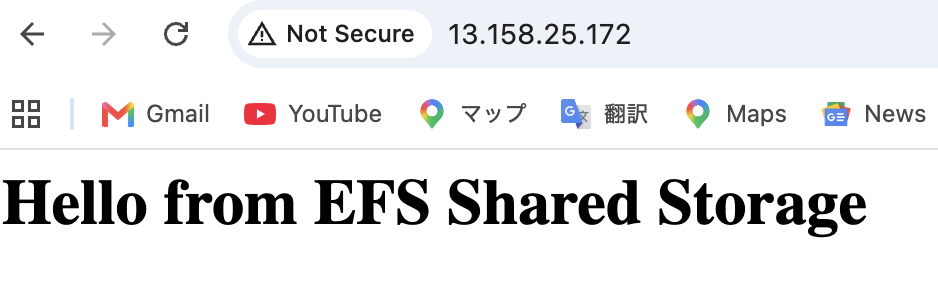

[English Version](./README.md)

# Amazon EFSを利用したマルチAZ Webサーバー向けの中央集権型共有ストレージ

##  プロジェクト概要
本プロジェクトでは、**Amazon Virtual Private Cloud (VPC)** 内の複数のアベイラビリティーゾーン (AZ) にデプロイされたWebサーバー向けに、**Amazon Elastic File System (EFS)** を用いた高可用性かつ中央集権型の共有ファイルシステムアーキテクチャを設計・実装しました。

単一のEFSファイルシステムを複数の**Amazon EC2**インスタンス上のApache (`httpd`) Webサーバーにマウントすることで、1つのサーバー上で作成されたWebコンテンツや静的アセットが、手動でのレプリケーションなしにすべてのサーバーで即座にアクセスおよび同期されることを実証しています。

---

## アーキテクチャとAWS構成
### Architecture Diagram

本環境は以下のコンポーネントで構成されています：
* **カスタムVPC (`10.0.0.0/16`)**: DNS解決およびDNSホスト名を有効化してゼロから構築。
* **パブリックサブネット**: 高可用性 (HA) を確保するため、2つの異なるAZ (`ap-northeast-1a` および `ap-northeast-1c`) にデプロイ。
* **EC2インスタンス**: 2台の Amazon Linux 2023 インスタンス (`Web-Server-1` および `Web-Server-2`) を起動。
* **セキュリティグループ**:
  * `EFS-Web-SG`: 任意の場所 (`0.0.0.0/0`) からのHTTP (ポート80) およびSSH (ポート22) を許可。
  * `EFS-Storage-SG`: `EFS-Web-SG` からのNFS (ポート2049) トラフィックのみを**厳密に**許可。
* **Amazon EFS**: 各パブリックサブネットにマウントターゲットを作成したリージョナルファイルシステム。

---

## 実装ステップ

### 1. セキュリティグループの設定
最小特権 (Least-privilege) のセキュリティ原則を適用するため、`EFS-Storage-SG` は `EFS-Web-SG` にアタッチされたインスタンスからのNFS (2049) 接続のみを許可するように設定しました。

### 2. EFSの作成とネットワーク設定
各サブネットにおいて、`EFS-Storage-SG` に関連付けられたマウントターゲットを持つリージョナルEFSファイルシステム (`My-Shared-EFS`) をプロビジョニングしました。

### 3. WebサーバーへのEFSのマウント
両方のEC2インスタンスに `amazon-efs-utils` をインストールし、ドキュメントルートディレクトリ `/var/www/html` にファイルシステムをマウントしました。

    # Install helper utilities
    sudo dnf install amazon-efs-utils -y

    # Mount EFS to Apache web directory
    sudo mount -t efs fs-07498b7a220a58497:/ /var/www/html

---

## トラブルシューティングと学んだ教訓

構築プロセスにおいて、実際のデプロイメントで発生しうるいくつかの技術的課題に直面し、それらを解決しました：

### 課題 1: `unknown filesystem type 'efs'`
* **根本原因**: Amazon Linux OSにEFSマウントヘルパーユーティリティがインストールされていなかった。
* **解決策**: `dnf` を使用して `amazon-efs-utils` をインストールした。

### 課題 2: `Could not resolve hostname` / タイムアウト
* **根本原因**: カスタムVPC作成時に**DNS解決**と**DNSホスト名**が有効化されておらず、EFSエンドポイントのDNSルックアップに失敗した。
* **解決策**: VPC設定にて両方のDNSフラグを有効化した。

### 課題 3: `Failed to import necessary dependency botocore`
* **根本原因**: EFSヘルパーツールがマウントターゲットのIPアドレスを取得するために、Pythonの `botocore` パッケージを必要としていた。
* **解決策**: `sudo dnf install python3-botocore -y` を実行して不足していた依存関係をインストールし、マウントを成功させた。

### 課題 4: ディレクトリコンテキストの更新に関する仕様 (Quirk)
* **根本原因**: `/var/www/html` ディレクトリ内にいる状態でEFSを同ディレクトリにマウントすると、シェルはマウント前のローカルディレクトリを参照したままになる。
* **解決策**: 一度 `/var/www/html` から抜けて再度入る (`cd /var/www/html`) か、ルートコンテキストを更新する (`sudo -i`) ことで、マウントされたEFSストレージが正常に表示されることを確認した。

---

## 動作確認と結果

**Web-Server-1** 上で `index.html` ファイルを作成し、パブリックブラウザリクエストを通じて両方のサーバーから検証を行いました：

1. **Web-Server-1 (Public IP: 3.112.123.55)**
   

2. **Web-Server-2 (Public IP: 13.158.25.172)**
   

**結論**: 独立した2台のWebサーバーが、中央集権型のAmazon EFSボリュームに保存された同一のWebページを正常に配信できることを確認しました。
